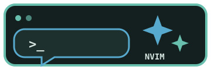

<p align="center">
  
</p>

<h3 align="center">A native Codex CLI chat panel for Neovim.</h3>

<p align="center">
  Chat with Codex from Neovim using your existing ChatGPT sign-in—no API key field or separate web app required.
</p>

<p align="center">
  <a href="https://neovim.io/"></a>
  <a href="https://github.com/openai/codex"></a>
  <a href="https://www.lua.org/"></a>
  <a href="https://github.com/folke/lazy.nvim"></a>
  <a href="https://archlinux.org/"></a>
</p>

---

## Tentang

`codex-panel.nvim` menghadirkan panel chat Codex langsung di Neovim. Plugin ini menjalankan `codex app-server` secara lokal dan memakai sesi login Codex CLI, sehingga kamu bisa login dengan akun ChatGPT melalui browser tanpa memasukkan API key ke konfigurasi plugin.

Panel dibuat dengan Lua dan API bawaan Neovim. Tidak perlu Telescope atau plugin UI tambahan.

## Fitur

- Chat Codex dari panel Neovim dengan pesan pengguna di kanan dan jawaban Codex di kiri.
- Login ChatGPT melalui browser memakai autentikasi Codex CLI.
- Menampilkan akun, model aktif, reasoning effort, dan sisa usage jika tersedia dari akun.
- Memilih model dan reasoning effort lewat menu Neovim.
- Riwayat percakapan lewat picker `<C-p>`.
- Konteks file aktif dan posisi kursor saat panel dibuka dari sebuah file.
- Persetujuan untuk aksi file/perintah Codex melalui menu Neovim.
- Enter untuk mengirim pesan; Shift-Enter untuk baris baru.
- Warna mengikuti highlight/tema Neovim.

## Logo & Teknologi

| Teknologi | Fungsi | Link |
| --- | --- | --- |
| Neovim | Editor dan UI panel | [neovim.io](https://neovim.io/) |
| Codex CLI | App-server, percakapan, dan autentikasi | [GitHub](https://github.com/openai/codex) |
| Lua | Bahasa plugin | [lua.org](https://www.lua.org/) |
| lazy.nvim | Plugin manager yang direkomendasikan | [GitHub](https://github.com/folke/lazy.nvim) |

## Struktur Project

```text
.
|-- assets/
|   `-- logo.svg
|-- lua/codex-panel/
|   `-- init.lua       # UI panel dan integrasi Codex app-server
|-- LICENSE
`-- README.md
```

## Prasyarat

- Neovim `0.10` atau lebih baru.
- [Codex CLI](https://github.com/openai/codex) terpasang dan perintah `codex` tersedia di `PATH`.
- Login ChatGPT di Codex CLI. Jika belum login, jalankan `codex login` di terminal atau pilih `L` / `login` dari panel untuk memulai login browser.
- `lazy.nvim` atau LazyVim untuk petunjuk instalasi di bawah.

> Plugin ini memakai autentikasi Codex CLI yang sudah ada. Jangan taruh token sesi atau API key di file konfigurasi.

## Instalasi di LazyVim / lazy.nvim

Setelah repo tersedia di GitHub, buat file `lua/plugins/codex-panel.lua` di konfigurasi Neovim dan masukkan spec berikut. Ganti owner jika repo diunggah dengan nama akun berbeda.

```lua
return {
  {
    "nabil-udah-kenyang/codex-panel.nvim",
    cmd = { "CodexPanel" },
    keys = {
      { "<leader>ac", "<cmd>CodexPanel<cr>", desc = "Toggle Codex panel" },
      { "<leader>acm", "<cmd>CodexPanel model<cr>", desc = "Choose Codex model" },
      { "<leader>acr", "<cmd>CodexPanel reasoning<cr>", desc = "Choose reasoning effort" },
    },
    config = function()
      require("codex-panel").setup()
    end,
  },
}
```

Simpan file, lalu jalankan `:Lazy sync` dan restart Neovim.

### Pengembangan lokal

Untuk mencoba salinan lokal tanpa menunggu instalasi GitHub, gunakan `dir` di spec:

```lua
{
  dir = "~/Documents/codex-panel.nvim",
  name = "codex-panel.nvim",
  cmd = { "CodexPanel" },
  keys = {
    { "<leader>ac", "<cmd>CodexPanel<cr>", desc = "Toggle Codex panel" },
  },
  config = function()
    require("codex-panel").setup()
  end,
}
```

## Cara Pakai

Buka panel dengan `<leader>ac` atau jalankan:

```vim
:CodexPanel
```

Kalau belum login, tekan `L` di panel atau jalankan `:CodexPanel login`. Browser akan dibuka untuk menyelesaikan login ChatGPT.

### Shortcut

| Shortcut | Fungsi |
| --- | --- |
| `<leader>ac` | Buka/tutup panel |
| `<leader>acm` / `m` | Pilih model |
| `<leader>acr` / `r` | Pilih reasoning effort |
| `<C-p>` / `c` | Pilih percakapan sebelumnya |
| `<C-n>` / `n` | Mulai percakapan baru |
| `L` | Login ChatGPT |
| `u` | Refresh informasi usage |
| `i` / `<C-j>` | Fokus ke kotak chat dan mulai mengetik |
| `<C-k>` | Fokus ke toolbar panel |
| `<CR>` di kotak chat | Kirim pesan |
| `<S-CR>` di kotak chat | Tambah baris baru |
| `q` | Tutup panel |

Kontrol di toolbar juga bisa diklik dengan mouse.

### Perintah

| Perintah | Fungsi |
| --- | --- |
| `:CodexPanel` | Toggle panel |
| `:CodexPanel new` | Percakapan baru |
| `:CodexPanel chats` | Pilih riwayat percakapan |
| `:CodexPanel login` | Login ChatGPT lewat browser |
| `:CodexPanel model` | Pilih model |
| `:CodexPanel reasoning` | Pilih reasoning effort |

## Troubleshooting

- **`codex` tidak ditemukan** — pastikan Codex CLI terpasang dan lokasi binarinya masuk `PATH` yang dipakai Neovim.
- **Login belum terbaca** — jalankan `codex login` dari terminal, atau pilih login dari panel, selesaikan proses browser, lalu buka kembali panel.
- **Usage tertulis unavailable** — informasi usage dapat tidak tersedia untuk sebagian status akun atau response app-server; chat tetap bisa digunakan.
- **Panel tidak muncul setelah instalasi** — cek plugin melalui `:Lazy`, jalankan `:Lazy sync`, lalu restart Neovim.

## Lisensi

Dirilis ke domain publik di bawah [The Unlicense](./LICENSE).
